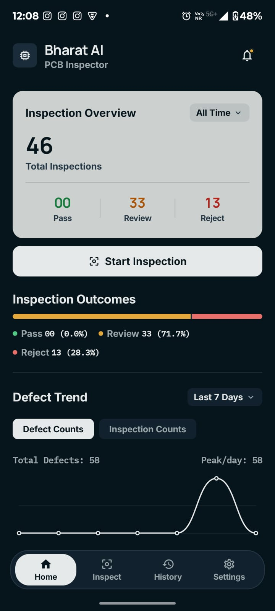
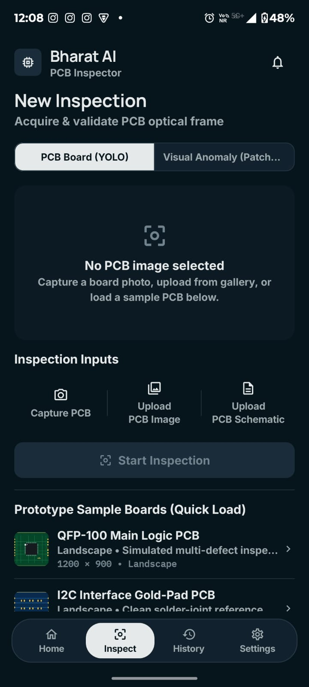
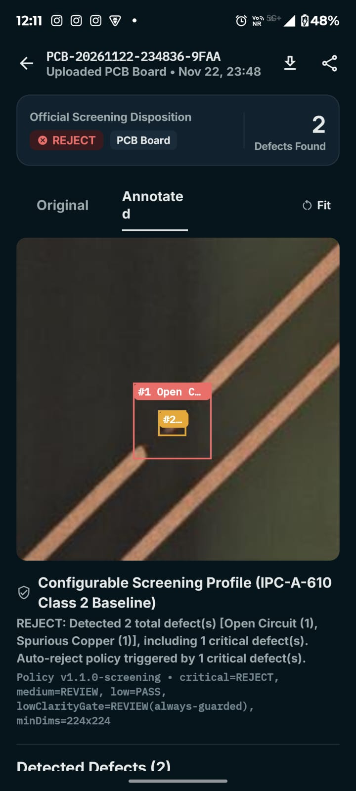
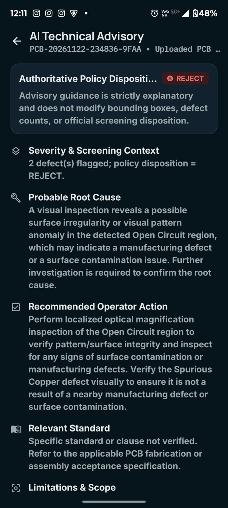
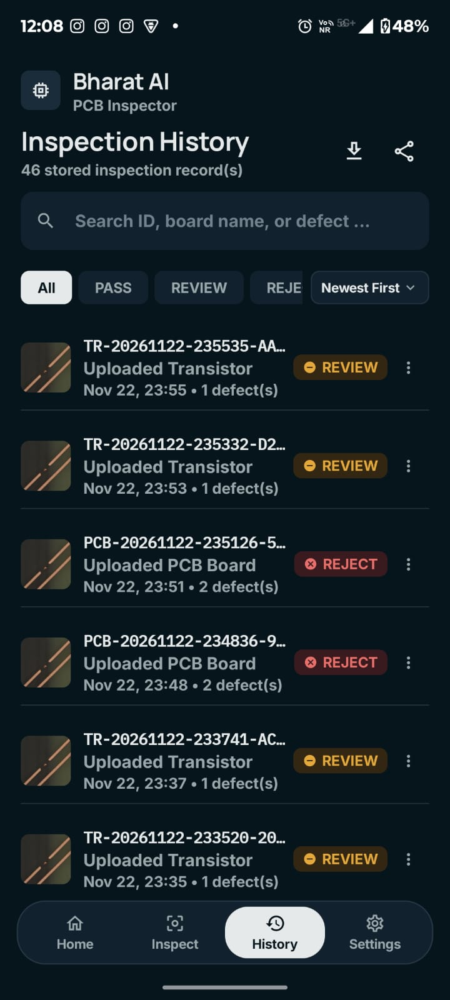
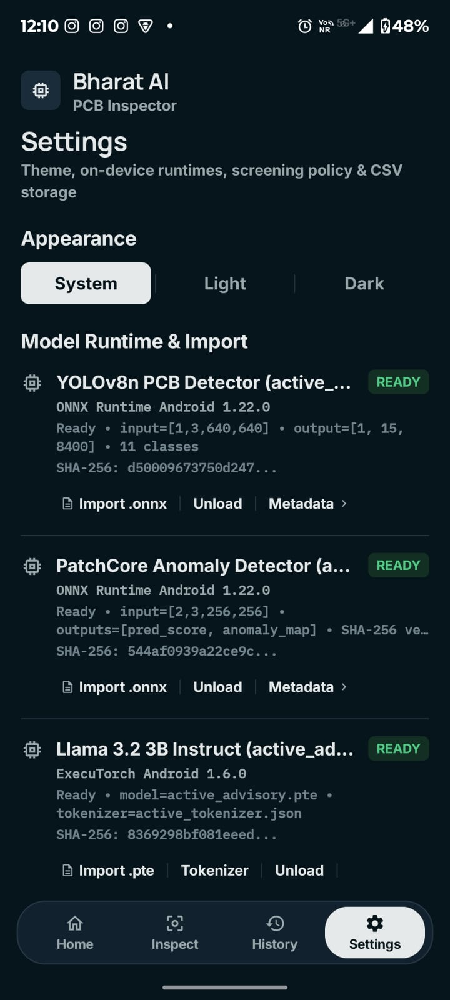
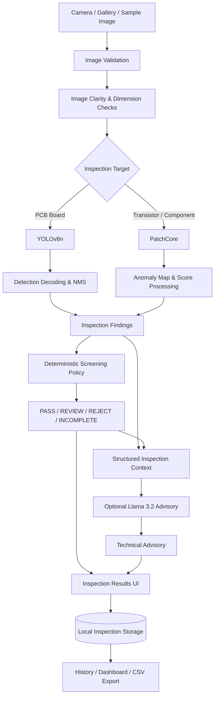
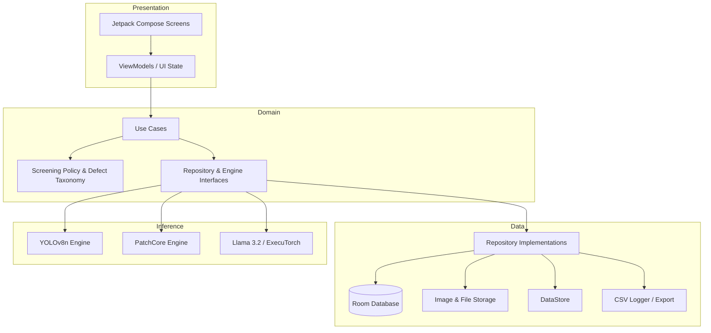

# Bharat AI PCB Inspector

**Offline-first, on-device AI for PCB defect detection and component anomaly inspection on Android.**

Bharat AI PCB Inspector is an Android application for AI-assisted optical inspection of printed circuit boards (PCBs) and electronic components. It integrates supervised object detection, unsupervised anomaly detection, deterministic screening logic, and an optional locally executed language model to support a multi-stage inspection workflow.

Designed specifically for **ARM-based Android SoCs**, the application explores deploying multiple AI workloads directly on mobile hardware. Its core inference pipeline operates locally, without depending on cloud inference APIs or continuous internet connectivity.

The project focuses on practical Edge AI deployment, including model integration, ARM CPU inference, runtime coexistence, memory utilization, latency characterization, and application-level inspection workflows on resource-constrained Android devices.

> **Offline-first · On-device inference · ARM-based Android · Computer Vision · Edge AI**

**Scope:** This application performs optical, image-based screening. It does not perform electrical testing, certify manufacturing quality, or replace qualified operator inspection. PASS / REVIEW / REJECT are screening dispositions under the configured application policy, not declarations of IPC compliance.

---

## Contents

- [Overview](#overview)
- [Screenshots](#screenshots)
- [Features](#features)
- [AI Models and Runtime](#ai-models-and-runtime)
- [PCB Defect Detection — YOLOv8n](#1-pcb-defect-detection--yolov8n)
- [Component Anomaly Detection — PatchCore](#2-component-anomaly-detection--patchcore)
- [AI Technical Advisory — Llama 3.2](#3-ai-technical-advisory--llama-32-3b-instruct)
- [Inspection Pipeline](#inspection-pipeline)
- [Screening Policy and Decision Logic](#screening-policy-and-decision-logic)
- [Application Features](#application-features)
- [Application Architecture](#application-architecture)
- [Technology Stack](#technology-stack)
- [On-device AI and ARM Deployment](#on-device-ai-and-arm-deployment)
- [Test Device](#test-device)
- [Performance Overview](#performance-overview)
- [Repository Structure](#repository-structure)
- [Download and Installation](#download-and-installation)
- [Model Assets](#model-assets)
- [Build from Source](#build-from-source)
- [Testing and Validation](#testing-and-validation)
- [Limitations and Responsible Use](#limitations-and-responsible-use)
- [Project Status and Future Work](#project-status-and-future-work)
- [License and Third-party Components](#license-and-third-party-components)
- [Disclaimer](#disclaimer)

---

## Overview

PCB inspection involves identifying visible manufacturing defects, localizing suspicious regions, interpreting inspection findings, and determining which areas require further verification.

Bharat AI PCB Inspector integrates three AI components and a deterministic screening layer:

| Component | Responsibility |
|---|---|
| **YOLOv8n** | Supervised PCB defect detection and bounding-box localization |
| **PatchCore** | Unsupervised visual anomaly detection for transistor/component inspection |
| **Llama 3.2 3B Instruct** | Contextual technical advisory and operator recommendations |
| **Deterministic Screening Policy** | Evaluates inspection findings and produces the application screening disposition |

The architecture deliberately separates model-generated findings, policy-based screening decisions, and LLM-generated explanations. This allows the application to provide AI-assisted guidance without delegating its official screening outcome to a generative model.

---

## Screenshots

### Application interface

| Home Dashboard | Inspection Screen |
|:---:|:---:|
|  |  |

| YOLO Inspection Result | YOLO AI Advisory |
|:---:|:---:|
|  |  |

| Inspection History | Settings |
|:---:|:---:|
|  |  |

---

## Features

### Image acquisition and inspection

- Capture PCB and component images using the device camera through CameraX.
- Import images from the device gallery.
- Load sample inspection images for demonstration.
- Support separate PCB defect-detection and component-anomaly inspection workflows.
- Validate image dimensions and assess image clarity before inference.
- Display selected images and inspection progress.

### Computer vision and AI

- Detect and localize PCB defects using YOLOv8n.
- Identify visually anomalous regions in transistor/component images using PatchCore.
- Display model findings, confidence information, anomaly metrics, and inference timings.
- Generate probable root-cause explanations and recommended operator actions using a local LLM.
- Display model provenance and advisory-generation metadata when available.

### Inspection results and record management

- Display PASS, REVIEW, REJECT, or INCOMPLETE screening outcomes.
- View original and annotated inspection images.
- Present defect labels, detection confidence, bounding boxes, and anomaly information.
- Store completed inspections locally.
- Search, filter, sort, and reopen previous inspection records.
- Export inspection findings through CSV.
- Configure screening policies and manage model artifacts through Settings.

### Offline-first execution

- Run computer vision models locally through ONNX Runtime.
- Execute language-model advisory locally through ExecuTorch.
- Avoid remote inference APIs for the core inspection workflow.
- Manage model artifacts independently from the APK.

---

## AI Models and Runtime

The application uses three model components with different inference responsibilities.

| Model | Task | Runtime | Execution |
|---|---|---|---|
| YOLOv8n | PCB defect detection | ONNX Runtime Android 1.22.0 | On-device |
| PatchCore | Component visual anomaly detection | ONNX Runtime Android 1.22.0 | On-device |
| Llama 3.2 3B Instruct | Technical advisory generation | ExecuTorch Android 1.6.0 | On-device |

### 1. PCB Defect Detection — YOLOv8n

YOLOv8n is used for supervised object detection and localization of PCB manufacturing defects.

The detector processes a supplied PCB image and produces defect-class predictions, confidence information, and bounding boxes identifying the detected regions.

The application-side pipeline includes:

1. Image preprocessing.
2. YOLOv8n model execution through ONNX Runtime.
3. Raw output decoding.
4. Non-maximum suppression (NMS).
5. Mapping model labels to the application's canonical defect taxonomy.
6. Passing processed findings to the deterministic screening policy.

#### Defect taxonomy

The current dataset taxonomy contains the following labels:

| Model Label | Canonical Interpretation |
|---|---|
| `open` | Open Circuit |
| `short` | Short Circuit |
| `mouse_bite` | Mouse Bite |
| `spur` | Spur |
| `spurious_copper` | Spurious Copper |
| `missing_copper` | Missing Copper |
| `copper_burr` | Copper Burr |
| `pin_hole` | Pin Hole |
| `hole_breakout` | Hole Breakout |
| `scratch` | Scratch |
| `copper` | Copper — dataset definition requires verification |

The raw model label is not treated as an independent quality verdict. Class mapping and severity handling are centralized in the application's domain taxonomy.

Unknown model labels are preserved and escalated for manual review rather than silently remapped to an existing defect category.

**Important:** YOLOv8n is limited to the defect categories represented by its training dataset. Its confidence score is a model prediction score, not a calibrated probability that a PCB is defective.

### 2. Component Anomaly Detection — PatchCore

PatchCore is used for visual anomaly detection in PCB and electronic component images.

Unlike the supervised YOLO detector, PatchCore evaluates deviations from learned normal visual appearance. It identifies suspicious regions that differ from the reference distribution learned during model preparation.

The application-side workflow includes:

1. Component image preparation.
2. PatchCore inference through ONNX Runtime.
3. Anomaly output and anomaly-map processing.
4. Extraction of anomaly-related metrics.
5. Mapping of the anomalous region into the inspection result.

The result interface can present:

- Raw anomaly score.
- Display anomaly score.
- Anomaly area.
- Highlighted anomalous region.
- Inference latency.

The normalized score shown in the application is a display-oriented transformation. It is **not a calibrated probability of physical component failure**. An anomaly indication represents visual deviation and requires operator assessment; it does not independently establish electrical malfunction.

### 3. AI Technical Advisory — Llama 3.2 3B Instruct

The advisory subsystem uses **Llama 3.2 3B Instruct**, executed locally through ExecuTorch Android 1.6.0.

The model receives structured inspection context after computer vision processing and deterministic screening. It generates explanatory information intended to help an operator understand findings and identify appropriate verification steps.

The advisory can include:

- **Probable Root Cause:** Possible manufacturing or surface-related explanations for the observed findings.
- **Recommended Operator Action:** Suggested inspection and verification steps.
- **Relevant Standards Context:** Applicable standards context where available and verified.
- **Limitations and Scope:** Explanation of what the visual inspection cannot establish.
- **Policy Context:** Summary of the authoritative screening disposition and relevant findings.

#### LLM runtime configuration

| Component | Configuration |
|---|---|
| Model | Llama 3.2 3B Instruct |
| Runtime | ExecuTorch Android 1.6.0 |
| Backend | XNNPACK |
| Execution device | CPU |
| Quantization | SpinQuant |
| Compiled artifact | `.pte` |
| KV cache | Enabled |

The model package includes the compiled model artifact, tokenizer data, and model configuration. Its approximate package size is **2.22 GiB** and is therefore distributed separately from the Android APK.

Advisory generation is optional. It can take substantially longer than computer vision inference and has a higher memory requirement on the currently tested device.

#### Advisory authority

The LLM is an explanatory component only. It must not:

- Modify YOLO detections or bounding boxes.
- Change defect classifications or defect counts.
- Alter model confidence values or PatchCore anomaly scores.
- Override the deterministic screening disposition.
- Present an unverified root-cause hypothesis as a confirmed diagnosis.

The core inspection and screening pipeline remains independent of LLM generation.

---

## Inspection Pipeline

The application separates image acquisition, model execution, screening, advisory generation, and result persistence.



### Stage 1 — Image acquisition

The user captures an image through the device camera or selects an existing image from the gallery. Sample images are also available for demonstration.

Camera-based acquisition is integrated through CameraX.

### Stage 2 — Image validation and preprocessing

The application validates image processability and checks relevant image properties before inference.

The validation workflow includes image-dimension checks and image-clarity assessment. Preprocessing is model-specific because YOLOv8n and PatchCore have different input contracts.

A low-clarity image can trigger a REVIEW outcome. Zero detected defects on a poor-quality image should not automatically be interpreted as a clean PASS.

### Stage 3 — Computer vision inference

The selected inspection engine executes locally:

- PCB inspection uses YOLOv8n.
- Component anomaly inspection uses PatchCore.

Both vision models use ONNX Runtime Android 1.22.0.

### Stage 4 — Output decoding and post-processing

Raw outputs are converted into application-level inspection findings.

For YOLO, this includes decoding, NMS, confidence handling, and defect-class mapping.

For PatchCore, anomaly outputs are processed into the application's anomaly score and localization representation.

### Stage 5 — Deterministic screening

The processed findings and image-quality information are evaluated against the active screening policy.

The policy generates the official screening disposition independently of the language model.

### Stage 6 — Optional AI advisory

The application builds structured inspection context and passes it to the locally running Llama model.

The advisory can explain possible causes and suggest operator actions. Failure or unavailability of advisory generation does not make the vision findings themselves an LLM decision.

### Stage 7 — Result presentation and persistence

The results interface displays the inspection findings, policy disposition, model metrics, and optional advisory.

Completed inspection records are stored locally and can be reopened from History or exported.

---

## Screening Policy and Decision Logic

A central design principle of Bharat AI PCB Inspector is the separation of **computer vision inference**, **deterministic screening**, and **LLM advisory**.

| Subsystem | Responsibility | Authority |
|---|---|---|
| Vision models | Produce defect detections and anomaly results | Model-derived findings |
| Post-processing | Decode outputs, map classes, and process anomaly results | Output processing |
| Deterministic screening policy | Evaluate findings against configured rules | Official application screening disposition |
| LLM advisory | Explain findings and suggest operator actions | Explanatory only |

### Screening dispositions

| Disposition | Meaning |
|---|---|
| **PASS** | No active screening rule requires escalation for the supplied image and findings. |
| **REVIEW** | The image or inspection findings require human assessment. |
| **REJECT** | A configured rejection condition has been triggered by the screening policy. |
| **INCOMPLETE** | A valid inspection result could not be completed. |

### Policy configuration

The screening policy evaluates the inspection findings, image-quality assessment, and active policy configuration.

The application includes controls and configuration for:

- Critical-, medium-, and low-severity handling.
- Critical-defect rejection rules.
- Image-quality safeguards.
- Minimum image dimensions.
- Guarded review pathways for low-clarity cases.
- Policy configuration and effective thresholds.
- Versioned policy snapshots associated with inspection records.

The policy also retains its rationale and effective threshold summary so the disposition can be interpreted in the context of the active configuration.

### IPC-A-610 Class 2 baseline profile

The repository identifies its default screening configuration as an **IPC-A-610 Class 2 baseline screening profile**.

This describes the configured reference profile only. It does not mean the application has been independently validated or certified against IPC-A-610 acceptance criteria.

Defect severities and thresholds remain provisional screening logic and require verification against the applicable standard, product class, and manufacturing process.

---

## Application Features

The application has four primary navigation destinations: **Home, Inspect, History, and Settings**.

### 1. Home — Inspection Dashboard

The dashboard summarizes inspection activity stored by the application.

It includes:

- Total inspection count.
- PASS, REVIEW, and REJECT distribution.
- Time-range selection for aggregate statistics.
- Inspection outcome visualization.
- Defect trend visualization.
- Defect-count and inspection-count chart views.
- Entry point to the inspection workflow.

### 2. Inspect — Input and Model Selection

The Inspect screen supports two inspection modes:

| Inspection Mode | Model | Intended Input |
|---|---|---|
| PCB Board | YOLOv8n | PCB assembly images |
| Visual Anomaly | PatchCore | Transistor/component images |

Input options include:

- Camera capture.
- Gallery image selection.
- Sample board/image loading.
- Schematic upload as additional context.
- Image preview before inference.

The application presents the selected inspection input and processing state during the workflow.

Sample scenarios are intended for demonstration. Sample/demo results should not be mixed with real production model inference results.

### 3. Inspection Results

The result screen presents the screening disposition and model-specific findings.

Common result information includes:

- Inspection type.
- Screening outcome.
- Defect or anomaly count.
- Original and annotated image views.
- Image fit control.
- Policy profile and policy explanation.
- Model provenance.
- Inference and processing latency.

YOLO results include localized bounding boxes, defect labels, and confidence information.

PatchCore results include the anomaly visualization and available anomaly metrics, such as raw score, display score, anomaly area, and inference latency.

### 4. AI Technical Advisory

The advisory screen presents generated explanatory information separately from the authoritative screening result.

Its sections include:

- Authoritative Policy Disposition.
- Severity and Screening Context.
- Probable Root Cause.
- Recommended Operator Action.
- Relevant Standard.
- Limitations and Scope.
- Execution Metadata.

When available, execution metadata includes model provenance, runtime, prompt-token count, generated-token count, generation duration, throughput, time-to-first-token (TTFT), and decode throughput.

Where a standards clause cannot be verified, the advisory should communicate that limitation rather than invent a specific clause.

### 5. Inspection History

Completed inspection records are stored locally and can be revisited without rerunning inference.

History supports:

- Inspection identifiers.
- Board/component labels.
- Timestamps.
- Defect counts.
- Screening dispositions.
- Search by inspection ID, board name, and defect-related terms.
- PASS, REVIEW, and REJECT filters.
- Newest-first sorting.
- Reopening previous inspection results.

### 6. Settings and Model Management

Settings provides model lifecycle controls, screening policy configuration, appearance options, and storage/export controls.

Appearance options include System, Light, and Dark themes.

#### Model artifact management

The application manages three model slots:

| Model Slot | Artifact Type | Runtime |
|---|---|---|
| YOLOv8n | ONNX | ONNX Runtime |
| PatchCore | ONNX | ONNX Runtime |
| Llama 3.2 3B Instruct | PTE + tokenizer/configuration assets | ExecuTorch |

Model management exposes readiness information and artifact operations, including:

- Import.
- Unload.
- Metadata inspection.
- Tokenizer management.
- Runtime/readiness information.
- Input/output metadata where applicable.
- SHA-256 information.

The application validates imported artifacts, but successful import does not establish model accuracy or production suitability.

### 7. CSV Export

Inspection data can be exported to CSV for external analysis, reporting, and archival.

The export is **defect-entry oriented**: multiple rows can share the same `inspection_id`.

An inspection with no detected defects may not generate a defect row. Therefore, CSV row counts must not be interpreted as total inspection counts.

---

## Application Architecture

The application follows a layered architecture separating presentation, domain logic, data access, and model inference.



### Presentation layer

Implemented using Jetpack Compose, the presentation layer renders screens, displays application state, and collects user interactions.

It presents loading, success, failure, unavailable, and completed inspection states. Model execution and the complete inspection workflow are not intended to be owned directly by composable screen functions.

### ViewModel and UI-state coordination

ViewModels coordinate screen-level actions and maintain UI-facing state. They connect user actions—such as starting an inspection or reopening a result—to the underlying application workflow.

### Domain layer

The domain layer contains application-level models, inspection use cases, repository/engine interfaces, defect taxonomy, and screening policy logic.

Keeping policy logic separate from UI and model runtime implementation helps maintain a clear boundary between inference output and application disposition.

### Data layer

The data layer handles inspection records, repositories, local storage, preferences, and CSV export.

Room is used for local inspection persistence, while image/file storage and DataStore handle their respective responsibilities.

### Inference layer

Dedicated inference components encapsulate model execution:

- YOLO defect-detection engine.
- PatchCore anomaly-detection engine.
- ExecuTorch advisory engine.

The advisory subsystem separately manages model initialization, prompt/context preparation, token generation, output handling, and generation metadata.

### Model lifecycle management

Model artifacts are handled independently of ordinary application data. The model-management workflow supports importing and validating the artifacts required by the corresponding inference components.

---

## Technology Stack

| Category | Technology |
|---|---|
| Programming Language | Kotlin |
| UI Framework | Jetpack Compose |
| UI Components | Material 3 |
| Architecture | ViewModels, domain use cases, repository interfaces |
| Navigation | Navigation Compose |
| Camera Integration | CameraX |
| Asynchronous Processing | Kotlin Coroutines and Flow |
| Local Database | Room |
| Preferences | DataStore |
| Image Loading | Coil |
| PCB Defect Detection | YOLOv8n |
| Component Anomaly Detection | PatchCore |
| Vision Model Runtime | ONNX Runtime Android 1.22.0 |
| LLM | Llama 3.2 3B Instruct |
| LLM Runtime | ExecuTorch Android 1.6.0 |
| LLM Backend | XNNPACK |
| Export | Local CSV logging and export |
| Unit Testing | JUnit |
| JVM/UI Testing | Robolectric, Compose UI tests |
| Device Testing | Android instrumentation tests |

---

## On-device AI and ARM Deployment

Bharat AI PCB Inspector is designed around the deployment of multiple inference workloads on a mobile Android platform.

The current implementation explores the following engineering areas:

### ARM-based CPU inference

The application executes the current model workloads on a physical ARM64 Android device. The vision pipelines use ONNX Runtime Android, while language-model execution uses ExecuTorch with the XNNPACK backend.

### Offline-first model execution

The core inference pipeline does not require a cloud inference endpoint. Model assets are installed and managed locally, and inference runs on the Android device.

Internet connectivity may still be required for downloading the APK or model assets. Offline-first describes local application execution after setup, not the download process.

### Multi-model runtime coexistence

The application integrates two ONNX-based computer vision workloads and an ExecuTorch-based language model.

Keeping multiple models resident can increase memory pressure, particularly on mobile devices with limited available RAM.

### Resource and performance characterization

The project investigates:

- Vision inference latency.
- LLM generation duration and throughput.
- Time-to-first-token and decode throughput.
- Process memory utilization.
- Memory/swap pressure.
- Runtime behavior when multiple models coexist.
- Practical constraints of on-device Edge AI deployment.

---

## Test Device

The current application and documented performance measurements were collected on a physical Android device.

| Component | Specification |
|---|---|
| Device | Motorola Moto G54 5G |
| Operating System | Android 15 |
| Android SDK | 35 |
| SoC | MediaTek Dimensity 7020 / MT6855 |
| CPU Architecture | ARM64 |
| Performance Cores | 2 × Arm Cortex-A78, up to 2.2 GHz |
| Efficiency Cores | 6 × Arm Cortex-A55, up to 2.0 GHz |
| GPU | IMG BXM-8-256 |
| RAM | 8 GB |
| ABI | `arm64-v8a` |

The SoC uses a heterogeneous CPU configuration with Cortex-A78 performance cores and Cortex-A55 efficiency cores. Android scheduling, memory availability, concurrent workloads, thermal conditions, and runtime state can influence inference behavior.

> **Testing scope:** The above configuration is the current physical-device validation target. These measurements do not establish equivalent performance or compatibility across all ARM-based Android devices.

---

## Performance Overview

Initial vision benchmarks were conducted on the physical test device.

| Model | Mean Total Pipeline Latency | Measurement Context |
|---|---:|---|
| YOLOv8n | **324.8 ms** | Mean of 5 runs; mean model inference component: 281 ms |
| PatchCore | **3,664.2 ms** | Mean total pipeline latency; model-only inference is not isolated by the current UI timing |

These figures are application-level pipeline measurements, not universal model-runtime performance guarantees.

LLM advisory generation introduces additional latency and memory overhead. Measurements include generated-token count, throughput, generation duration, TTFT, decode throughput, and process-memory observations when available.

The Llama model is resource-intensive on the current 8 GB device. Benchmark observations show substantial memory and swap pressure when vision models and the LLM are resident together.

**Detailed benchmark methodology, repeated-run results, LLM generation metrics, memory observations, and analysis are documented separately in [`benchmark.md`](benchmark.md).**

> These are exploratory measurements from a single device, not a cross-device comparison, formal model-accuracy evaluation, or controlled sustained-throughput and thermal study.

---

## Repository Structure

The Android application is organized into separate modules for application startup, data handling, domain logic, model inference, navigation, presentation, storage, and image processing.

```text
Bharat-AI-PCB-Inspector/
│
├── android/
│   ├── app/
│   │   ├── src/
│   │   │   ├── main/
│   │   │   │   └── java/com/example/
│   │   │   │       ├── app/              # Application container and startup
│   │   │   │       ├── data/             # Repositories, Room, preferences, CSV
│   │   │   │       ├── domain/           # Models, policies, interfaces, use cases
│   │   │   │       ├── inference/        # YOLO, PatchCore, ExecuTorch, model manager
│   │   │   │       ├── navigation/       # App navigation
│   │   │   │       ├── presentation/     # Compose screens, components, ViewModels
│   │   │   │       ├── storage/          # Image and file storage
│   │   │   │       └── imageprocessing/  # Image decoding and processing
│   │   │   │
│   │   │   ├── test/                     # JVM/unit tests
│   │   │   └── androidTest/              # Device/instrumentation tests
│   │   │
│   │   ├── libs/                         # Local ExecuTorch AAR dependency
│   │   └── build.gradle.kts
│   │
│   ├── gradle/
│   ├── gradlew
│   ├── screenshots/
│   │   ├── home_page.jpeg
│   │   ├── inspection_screen.jpeg
│   │   ├── yolo_result.jpeg
│   │   ├── yolo_advisory.jpeg
│   │   ├── history_screen.jpeg
│   │   └── settings_screen.jpeg
│   │
│   ├── benchmark.md
│   └── README.md
│
└── ...
```

---

## Download and Installation

### Android APK

The current published release is **[v0.1.0](https://github.com/radicalSanta/Bharat-AI-PCB-Inspector/releases/tag/v0.1.0)**.

| Artifact | Description |
|---|---|
| [Download APK](https://github.com/radicalSanta/Bharat-AI-PCB-Inspector/releases/download/v0.1.0/app-release.apk) | Android release APK |
| [SHA256SUMS.txt](https://github.com/radicalSanta/Bharat-AI-PCB-Inspector/releases/download/v0.1.0/SHA256SUMS.txt) | SHA-256 checksums |
| [GitHub Releases](https://github.com/radicalSanta/Bharat-AI-PCB-Inspector/releases) | Release history |

The v0.1.0 release APK is approximately **117.9 MB**. Model files are distributed separately to reduce the APK package size.

### Installation steps

1. Download `app-release.apk` from the GitHub Releases page.
2. Verify the APK checksum using the accompanying `SHA256SUMS.txt`.
3. Install the APK on a compatible Android device. Android may require permission to install applications from the selected download source.
4. Download the required model assets from the model-assets folder.
5. Open the application's model-management interface.
6. Import and validate the required model artifacts.
7. Run the corresponding inspection or advisory workflow.

### Model downloads

**[Download Model Assets](https://drive.google.com/drive/folders/1Lveex3x1ncNOlms8069mATbmIOqra51r?usp=drive_link)**

The model package includes the required artifacts and supporting files. The corresponding model must be installed and validated before its inference functionality can be used.

---

## Model Assets

Models are managed independently from the Android APK.

| Model Slot | Role | Runtime |
|---|---|---|
| PCB Detection | PCB defect classification and localization | ONNX Runtime |
| Transistor/Component Anomaly | Visual anomaly screening | ONNX Runtime |
| AI Advisory | Contextual explanation and operator recommendations | ExecuTorch |

### Artifact handling

- Download model artifacts from the supplied model-assets folder.
- Import artifacts through the in-app model-management workflow.
- Use matching model, tokenizer, and configuration files.
- Do not mix artifacts from different model exports unless explicitly supported.
- Check model readiness and metadata after import.

The LLM package includes its compiled `.pte` model, tokenizer data, and configuration files. Its approximate size is 2.22 GiB.

Successful artifact import or validation confirms packaging/readiness checks; it does not establish scientific accuracy or suitability for a particular production line.

---

## Build from Source

### Prerequisites

- Android Studio or Android SDK command-line tools.
- A JDK compatible with the Gradle and Android Gradle Plugin versions configured by the project.
- Android SDK Platform and Build Tools matching the project's compile SDK configuration.
- The ExecuTorch AAR dependency at `android/app/libs/executorch.aar`.

The repository includes the ExecuTorch AAR under `android/app/libs/`. The Gradle build script also contains a developer-machine-specific fallback path. Contributors should use the repository-local AAR rather than relying on a machine-specific fallback.

### Clone the repository

```bash
git clone https://github.com/radicalSanta/Bharat-AI-PCB-Inspector.git
cd Bharat-AI-PCB-Inspector/android
```

### Build a debug APK

```bash
./gradlew assembleDebug
```

The debug APK is generated under:

```text
app/build/outputs/apk/debug/app-debug.apk
```

### Run unit tests

```bash
./gradlew testDebugUnitTest
```

### Run instrumentation tests

Connect a compatible Android device or start an emulator, then run:

```bash
./gradlew connectedDebugAndroidTest
```

Android Studio may create a local `local.properties` file containing the Android SDK path. Do not commit machine-specific SDK paths or secrets.

---

## Testing and Validation

The repository includes tests for important application components and processing paths, including:

- Inspection policy and defect taxonomy.
- Inspection orchestration and domain integration.
- YOLO preprocessing, output decoding, and detection pipeline behavior.
- PatchCore input contracts, preprocessing, output decoding, and inference behavior.
- Model import and lifecycle management.
- Advisory prompt construction and output parsing.
- Generation budgeting and tokenizer behavior.
- ExecuTorch integration.
- Image decoding and validation.
- ViewModels and Compose UI behavior.
- Device-side advisory inference.

Software tests verify the tested implementation paths. They do not establish model accuracy, industrial suitability, or standards compliance.

Those require representative datasets, independent model evaluation, and controlled device and production-line validation.

---

## Limitations and Responsible Use

- The application performs optical, image-based inspection and does not measure electrical continuity, resistance, impedance, signal integrity, or circuit behavior.
- A 2D image cannot establish the condition of internal PCB layers or hidden defects.
- Image quality, lighting, focus, orientation, board geometry, and resolution affect model results.
- YOLOv8n may produce false positives and false negatives and is limited to its learned defect taxonomy.
- A detector confidence score is not a calibrated probability that a board is defective.
- PatchCore identifies visual deviations; an anomaly is not automatically a physical defect.
- PatchCore display scores are not calibrated probabilities of failure.
- Defect severities and screening thresholds are tied to the configured dataset taxonomy and provisional screening policy.
- The IPC-A-610 Class 2 reference profile is not proof of certification, compliance, or independent standards validation.
- The LLM can generate inaccurate, incomplete, or speculative explanations. Root-cause suggestions require independent verification.
- Sample/demo inspections must not be confused with production model inference.
- Keeping multiple models resident can cause substantial memory consumption and swap activity on devices with limited available RAM.
- Compatibility and performance can vary across Android versions, SoCs, CPU architectures, memory configurations, and device vendors.
- Final acceptance decisions should follow the organization's validated inspection procedure and be made by qualified personnel.

---

## Project Status and Future Work

**Current Release: v0.1.0**

Bharat AI PCB Inspector is an experimental engineering prototype exploring mobile computer vision, offline-first AI, and Edge AI deployment on ARM-based Android devices.

Current development areas include Android integration, local model execution, inspection-result handling, deterministic screening, advisory generation, model lifecycle management, and runtime profiling.

### Future Work

- Improve model inference performance and efficiency.
- Optimize memory consumption during multi-model execution.
- Explore hardware acceleration on supported Android SoCs.
- Improve image preprocessing and inspection reliability.
- Expand defect coverage and validation datasets.
- Improve local LLM generation efficiency and resource management.
- Extend device-level testing across additional ARM-based Android platforms.
- Improve inspection traceability and model/policy provenance.

---

## License and Third-party Components

Application source code, model weights, datasets, and third-party dependencies may have separate licensing terms.

Review the respective licenses and usage terms for model weights, ONNX Runtime, ExecuTorch, and other bundled or integrated components before redistribution or commercial deployment.

Do not assume that a model's source-code license automatically grants unrestricted rights to its weights or training data.

---

## Disclaimer

Bharat AI PCB Inspector is intended for experimental, educational, and engineering research purposes.

It is an assistive visual-inspection prototype, not a certified PCB quality-control, manufacturing acceptance, or safety-verification system. AI-generated findings and screening outcomes are not guaranteed to be accurate.

The application does not replace qualified inspection personnel, electrical testing, or applicable PCB fabrication and assembly acceptance procedures. Consequential screening and production decisions must be independently verified.
